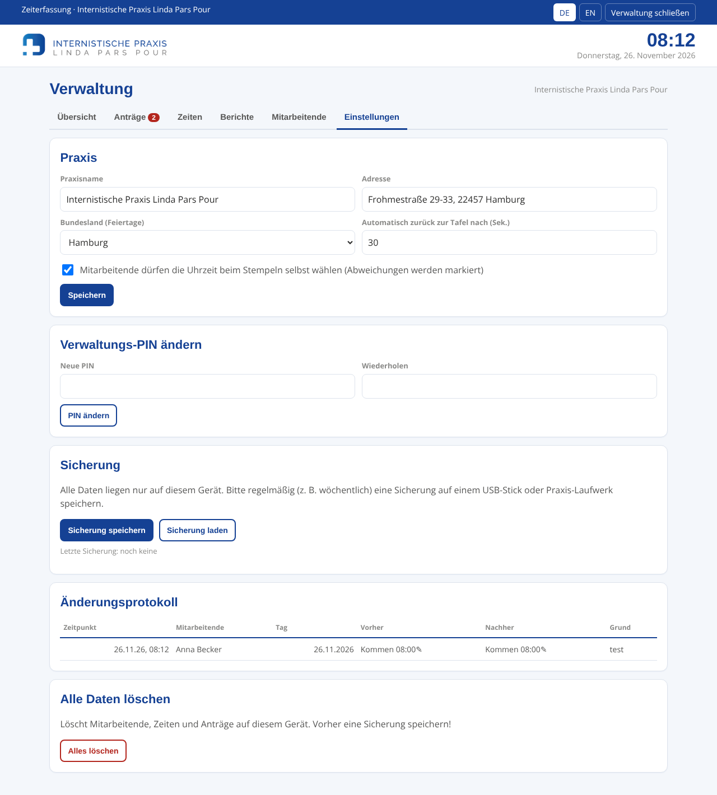

# Benutzerhandbuch – Zeiterfassung

**Internistische Praxis Linda Pars Pour** · Frohmestraße 29-33, 22457 Hamburg

Version 1.0 · November 2026

---

## Inhalt

1. Einführung
2. Einrichtung und Installation

**Teil A – Für Mitarbeitende**

3. Ein- und Ausstempeln
4. Mein Bereich
5. Anträge stellen
6. Häufige Fragen der Mitarbeitenden

**Teil B – Für die Praxisleitung**

7. Die Verwaltung öffnen und schließen
8. Übersicht
9. Anträge bearbeiten
10. Zeiten prüfen und korrigieren
11. Mitarbeitende verwalten
12. Monatsberichte (Excel und PDF)
13. Einstellungen, Sicherung und Änderungsprotokoll
14. Monatlicher Ablauf – Checkliste
15. Fehlerbehebung

**Anhang**

16. Begriffe
17. Datenschutz und Sicherheit

---

## 1. Einführung

Die Zeiterfassung dokumentiert die Arbeitszeiten aller Mitarbeitenden der Praxis: Beginn, Pausen und Ende jedes Arbeitstages. Sie läuft auf **einem gemeinsamen Gerät** am Empfang (Tablet oder PC).

Es gibt zwei Rollen:

| Rolle | Wer | Was |
|---|---|---|
| **Mitarbeitende** | MFA, Auszubildende, weitere Angestellte | Stempeln mit eigener PIN, eigene Zeiten ansehen, Anträge stellen |
| **Praxisleitung** | Frau Pars Pour (und ggf. Praxismanagement) | Alles sehen, Anträge genehmigen, Zeiten korrigieren, Berichte erstellen, Mitarbeitende verwalten |

**Wichtig:** Alle Daten werden **nur auf diesem Gerät** gespeichert. Nichts wird ins Internet übertragen. Deshalb ist eine regelmäßige Sicherung wichtig (siehe Kapitel 13).

---

## 2. Einrichtung und Installation

### 2.1 App auf dem Gerät installieren

1. Auf dem Tablet oder PC den Browser **Chrome** (oder Edge) öffnen.
2. Die Adresse der App aufrufen: **https://ario-ghs.github.io/praxis-zeiterfassung/**
3. Als App installieren:
    - **Tablet (Android):** Menü (drei Punkte) → **App installieren** bzw. **Zum Startbildschirm hinzufügen**.
    - **iPad:** In Safari auf **Teilen** → **Zum Home-Bildschirm**.
    - **PC (Chrome/Edge):** Rechts in der Adressleiste auf das Symbol **Installieren** klicken.
4. Die App ab jetzt immer über das neue Symbol öffnen.

> **Tipp:** Das Gerät sollte am Empfang fest stehen, am Stromnetz hängen und sich nicht automatisch sperren (Bildschirmsperre in den Geräteeinstellungen verlängern).

### 2.2 Ersteinrichtung

Beim ersten Start erscheint die Ersteinrichtung.

1. **Praxisname** prüfen.
2. Eine **Verwaltungs-PIN** (4 Ziffern) festlegen und wiederholen. Diese PIN kennt nur die Praxisleitung.
3. **Einrichtung abschließen** klicken. Die App öffnet direkt die Verwaltung, damit Sie die Mitarbeitenden anlegen können (Kapitel 11).

> **Zum Ausprobieren:** **Mit Demo-Daten starten** legt vier Beispiel-Mitarbeitende mit erfundenen Daten an (PINs 1111, 2222, 3333, 4444; Verwaltung 0000). Vor dem echten Einsatz unter **Einstellungen → Alles löschen** entfernen und neu einrichten.

---

# Teil A – Für Mitarbeitende

## 3. Ein- und Ausstempeln

### 3.1 Die Stempeltafel

Die Startseite zeigt für jede Person eine Karte mit dem aktuellen Status.

| Farbe oben an der Karte | Status |
|---|---|
| Grün | **Anwesend** |
| Orange | **In Pause** |
| Blau | **Urlaub** oder **Krank** (genehmigt) |
| Grau | **Nicht da** oder **Feierabend** |

### 3.2 Stempeln – Schritt für Schritt

1. Auf die **eigene Karte** tippen.
2. Die **eigene PIN** (4 Ziffern) eingeben.

    

3. Den passenden Knopf drücken:

    

    | Knopf | Wann |
    |---|---|
    | **Kommen** | Bei Arbeitsbeginn |
    | **Pause beginnen** | Zu Beginn jeder Pause |
    | **Pause beenden** | Wenn die Pause vorbei ist |
    | **Gehen** | Bei Arbeitsende |

4. Eine kurze Bestätigung erscheint, z. B. „Willkommen, Anna – 07:52“. Danach kehrt die App **automatisch zur Stempeltafel** zurück.

Es sind immer nur die Knöpfe aktiv, die gerade sinnvoll sind (z. B. kein „Gehen“, bevor man „Kommen“ gedrückt hat).

### 3.3 Mehrere Pausen

Es können beliebig viele Pausen pro Tag gestempelt werden. Alle Pausen werden addiert und von der Arbeitszeit abgezogen.

### 3.4 Nachtdienst und Dienst über Mitternacht

Wer nach Mitternacht (bis 12 Uhr mittags) „Gehen“ stempelt und am Vortag „Kommen“ gestempelt hat, wird automatisch dem **Vortag** zugeordnet. Die Uhrzeit erscheint dann mit „(+1)“.

### 3.5 Datenschutz am Empfang

- Die eigene PIN **niemandem verraten**.
- Nach dem Stempeln kehrt die App selbst zur Tafel zurück. Ansonsten **Fertig** drücken.
- Nach 30 Sekunden ohne Eingabe schließt sich der persönliche Bereich automatisch.

---

## 4. Mein Bereich

Nach der PIN-Eingabe sehen Sie unter den Stempel-Knöpfen:

**Heute**

- alle heutigen Stempelzeiten,
- **Arbeitszeit** (ohne Pausen), **Pause** und **Soll** für heute.

**Mein Monat**

- **Ist:** gearbeitete Stunden im laufenden Monat,
- **Soll:** vertraglich vereinbarte Stunden bis heute,
- **Überstunden-Saldo:** alle Plus- und Minusstunden seit Beginn der Zeiterfassung (grün = Plus, rot = Minus),
- **Resturlaub:** verbleibende Urlaubstage im Kalenderjahr.

Hinweise zu Pausen nach dem Arbeitszeitgesetz erscheinen gelb, z. B. „Über 6 Std. Arbeit, weniger als 30 Min. Pause“.

---

## 5. Anträge stellen

Im Bereich **Mein Monat** gibt es vier Knöpfe:

| Knopf | Zweck |
|---|---|
| **Urlaub beantragen** | Urlaubstage beantragen |
| **Krank melden** | Krankheitstage melden |
| **Überstunden abbauen** | Freie Tage zum Abbau von Überstunden beantragen |
| **Zeitkorrektur** | Einen Fehler in den eigenen Stempelzeiten melden |

### 5.1 Urlaub, Krankheit, Überstundenabbau

1. Knopf antippen.
2. **Von** und **Bis** wählen, optional eine Bemerkung eintragen.

    

3. **Antrag senden** drücken.

Der Antrag ist zunächst **offen**. Er zählt erst, wenn die Praxisleitung ihn **genehmigt** hat. Den Status sehen Sie unter **Meine Anträge**.

> **Krankmeldung:** Die Arbeitsunfähigkeitsbescheinigung (AU) wie gewohnt an die Praxisleitung geben. Der Eintrag in der App ersetzt sie nicht.

### 5.2 Zeitkorrektur

Mitarbeitende können ihre Zeiten **nicht selbst ändern**. So bleiben die Aufzeichnungen verlässlich. Bei einem Fehler:

1. **Zeitkorrektur** antippen.
2. Das **Datum** wählen und genau beschreiben, was falsch ist, z. B. „Gehen vergessen, war bis 16:45 da“.

    

3. **Antrag senden** drücken. Die Praxisleitung korrigiert den Tag.

---

## 6. Häufige Fragen der Mitarbeitenden

**Ich habe meine PIN vergessen.**
Die Praxisleitung vergibt eine neue PIN (Kapitel 11.4).

**Die PIN wird nicht angenommen.**
Die Punkte wackeln, wenn die PIN falsch ist. Erneut eingeben. Prüfen, ob die richtige Karte angetippt wurde.

**Ich habe vergessen, „Gehen“ zu stempeln.**
Am nächsten Tag einen Antrag **Zeitkorrektur** stellen. Die Verwaltung zeigt der Praxisleitung zusätzlich automatisch einen Hinweis.

**Ich habe aus Versehen „Pause“ gedrückt.**
Sofort **Pause beenden** drücken und eine **Zeitkorrektur** beantragen, falls nötig.

**Warum steht mein Saldo im Minus?**
Der Saldo vergleicht die gearbeiteten Stunden mit den vertraglichen Sollstunden. Fehlende Tage ohne Eintrag oder offene Anträge können ihn senken. Bei Fragen die Praxisleitung ansprechen.

---

# Teil B – Für die Praxisleitung

## 7. Die Verwaltung öffnen und schließen

1. Oben rechts auf **Verwaltung** tippen.
2. Die **Verwaltungs-PIN** eingeben.

    

3. Zum Schließen oben rechts **Verwaltung schließen** tippen.

Die Verwaltung schließt sich nach **3 Minuten** ohne Eingabe automatisch, damit am Empfang niemand Unbefugtes Zugriff hat.

Oben gibt es sechs Reiter: **Übersicht, Anträge, Zeiten, Berichte, Mitarbeitende, Einstellungen.** Die rote Zahl am Reiter „Anträge“ zeigt offene Anträge.

---

## 8. Übersicht

Die Tabelle **Jetzt** zeigt für jede Person:
- **Status** (anwesend, in Pause, nicht da, Urlaub, krank),
- **Kommen:** heutige Ankunftszeit,
- **Heute:** bisherige Arbeitszeit,
- **Saldo:** aktueller Überstunden-Saldo.

Darunter erscheinen automatisch Hinweise:
- **Offene Anträge** → **Ansehen** führt zum Reiter „Anträge“.
- **Gestern kein „Gehen“ erfasst** (rot) → **Korrigieren** öffnet den Tag direkt.
- **Arbeitstage ohne Eintrag** in den letzten 14 Tagen → **Ansehen** öffnet die Zeiten der Person.

---

## 9. Anträge bearbeiten

### 9.1 Genehmigen oder ablehnen

1. Reiter **Anträge** öffnen.
2. Beim Antrag **Genehmigen** oder **Ablehnen** wählen.
3. Optional einen **Kommentar** eintragen und bestätigen.

    

| Antragsart | Wirkung nach Genehmigung |
|---|---|
| **Urlaub** | Tage zählen als Urlaub. Sollzeit gilt als erfüllt. Resturlaub sinkt. |
| **Krankmeldung** | Tage zählen als krank. Sollzeit gilt als erfüllt. |
| **Überstundenabbau** | Tage sind frei. Das Soll des Tages wird vom Saldo abgezogen. |
| **Zeitkorrektur** | Nur Erinnerung. Mit **Tag öffnen** die Zeiten korrigieren (Kapitel 10.3), danach **Erledigt** drücken. |

Abgelehnte Anträge zählen nicht. Alle entschiedenen Anträge stehen unter **Verlauf**.

### 9.2 Krankheit oder Urlaub direkt eintragen

Wenn sich jemand telefonisch krank meldet:

1. Oben rechts die **Person** auswählen.
2. **Krankheit eintragen** (oder **Urlaub eintragen**) drücken.
3. Zeitraum und Bemerkung eingeben, **Eintragen** drücken.

    

Direkt eingetragene Abwesenheiten sind sofort genehmigt.

---

## 10. Zeiten prüfen und korrigieren

### 10.1 Monatsansicht

1. Reiter **Zeiten** öffnen.
2. **Person** und **Monat** auswählen.

Oben stehen **Ist**, **Soll**, **Differenz im Monat** und **Saldo gesamt**. Die Tabelle zeigt jeden Tag mit Uhrzeiten, Pausen, Soll, Ist und Abweichung. Jede Kalenderwoche beginnt mit einer Summenzeile.

### 10.2 Markierungen in der Tabelle

| Markierung | Bedeutung |
|---|---|
| **fehlt** (rot) | Arbeitstag mit Sollstunden, aber ohne Eintrag und ohne Antrag |
| **Urlaub / Krank / Feiertag** | Genehmigte Abwesenheit oder gesetzlicher Feiertag |
| **… offen** (orange) | Antrag für diesen Tag wartet auf Entscheidung |
| ⚠ | Hinweis nach dem Arbeitszeitgesetz (Pausen, Höchstarbeitszeit, Ruhezeit) |
| Grauer Hintergrund | Tag ohne Sollstunden (z. B. Wochenende) |

### 10.3 Einen Tag korrigieren oder nachtragen

1. Die **Zeile des Tages** anklicken (oder **Tag bearbeiten / nachtragen**).
2. Stempelzeiten ändern, hinzufügen (**+ Eintrag**) oder entfernen (**✕**).
3. Bei Diensten über Mitternacht **+1** ankreuzen.
4. Optional eine **Bemerkung** eintragen. Sie erscheint im Bericht.
5. Den **Grund der Änderung** eintragen (Pflichtfeld).
6. **Speichern** drücken.

Jede Änderung wird mit Zeitpunkt, alten und neuen Werten und Grund im **Änderungsprotokoll** gespeichert (Kapitel 13.4). So bleibt jederzeit nachvollziehbar, was korrigiert wurde.

---

## 11. Mitarbeitende verwalten

### 11.1 Neue Person anlegen

1. Reiter **Mitarbeitende** → **+ Neu anlegen**.
2. Felder ausfüllen (siehe Tabelle).
3. **Speichern** drücken. Die Person erscheint sofort auf der Stempeltafel.

| Feld | Erklärung |
|---|---|
| **Vorname, Nachname** | Wird auf der Stempeltafel und in den Berichten angezeigt |
| **Funktion** | z. B. MFA, Praxismanagerin, Auszubildende/r MFA |
| **Vertrag** | Vollzeit, Teilzeit, Minijob, Ausbildung, Werkstudent |
| **Sollstunden pro Wochentag** | Vertragliche Stunden je Tag (siehe 11.2) |
| **Urlaubstage/Jahr** | Vertraglicher Jahresurlaub |
| **Resturlaub Vorjahr** | Übertragene Tage aus dem Vorjahr |
| **Überstunden-Übertrag** | Saldo in Stunden zu Beginn der Zeiterfassung (z. B. 5,5 oder -2) |
| **Zeiterfassung ab** | Ab diesem Datum wird gerechnet (z. B. Einführungstag oder Eintrittsdatum) |
| **PIN** | 4 Ziffern. Bitte der Person persönlich mitteilen. |

Bis zu **10 aktive Mitarbeitende** sind möglich.

### 11.2 Variable Schichten

Für jeden Wochentag werden die **vertraglichen Sollstunden** eingetragen, z. B.:

| Mo | Di | Mi | Do | Fr | Sa | So |
|---|---|---|---|---|---|---|
| 8 | 8 | 4 | 8 | 6 | 0 | 0 |

Die **tatsächlichen Uhrzeiten** dürfen jeden Tag anders sein. Die App vergleicht nur die gearbeiteten Stunden mit dem Soll des Tages. An **gesetzlichen Feiertagen** (Hamburg) ist das Soll automatisch 0.

### 11.3 Daten ändern

Bei der Person **Bearbeiten** drücken, Werte ändern, **Speichern**.

### 11.4 Neue PIN vergeben

**Bearbeiten** → im Feld **Neue PIN** vier Ziffern eintragen → **Speichern**. Bleibt das Feld leer, bleibt die alte PIN gültig.

### 11.5 Person deaktivieren (Austritt)

**Bearbeiten** → Haken bei **Aktiv** entfernen → **Speichern**. Die Person verschwindet von der Stempeltafel. Ihre Zeiten und Berichte bleiben erhalten.

---

## 12. Monatsberichte (Excel und PDF)

1. Reiter **Berichte** öffnen und den **Monat** wählen.
2. Die Tabelle zeigt für alle Personen Arbeitstage, Soll, Ist, Differenz, Saldo, Urlaub, Resturlaub, Krankheitstage und fehlende Tage. Ein Klick auf eine Zeile öffnet die Zeiten der Person.
3. Export wählen:
    - **Excel – alle Mitarbeitenden:** eine Datei mit Übersichtsblatt und einem Blatt pro Person.
    - **PDF – alle Mitarbeitenden:** eine Übersichtsseite und eine Seite pro Person.
    - Oder unten eine **einzelne Person** wählen und **Excel** bzw. **PDF** drücken.
4. Die Datei wird im Ordner **Downloads** gespeichert.

**Übersichtsseite im PDF:**

**Seite pro Person** mit allen Tagen, Wochensummen, Monatssumme und Unterschriftsfeldern:

> **Empfehlung:** Die PDF-Seite jeder Person ausdrucken, von der Person und der Praxisinhaberin unterschreiben lassen und ablegen. Die Excel-Datei eignet sich für die Lohnabrechnung bzw. das Steuerbüro.

---

## 13. Einstellungen, Sicherung und Änderungsprotokoll

### 13.1 Praxisdaten
Praxisname, Adresse, **Bundesland** (bestimmt die Feiertage) und die Zeit, nach der die App zur Stempeltafel zurückkehrt.

### 13.2 Verwaltungs-PIN ändern
Neue PIN zweimal eingeben → **PIN ändern**.

### 13.3 Sicherung (sehr wichtig)
Weil alle Daten nur auf diesem Gerät liegen, gehen sie bei Defekt, Verlust oder Zurücksetzen des Geräts verloren.

- **Sicherung speichern:** erstellt eine Datei (z. B. `Zeiterfassung_Sicherung_2026-11-25.json`) im Download-Ordner. Diese Datei **wöchentlich** auf einen USB-Stick oder ein Praxis-Laufwerk kopieren.
- **Sicherung laden:** stellt alle Daten aus einer Sicherungsdatei wieder her, z. B. auf einem neuen Gerät.

Das Datum der letzten Sicherung steht unter den Knöpfen.

### 13.4 Änderungsprotokoll
Zeigt die letzten Korrekturen mit Zeitpunkt, Person, Tag, vorher, nachher und Grund.

### 13.5 Alle Daten löschen
Entfernt alle Mitarbeitenden, Zeiten und Anträge vom Gerät. Zur Sicherheit zweimal klicken. **Vorher eine Sicherung speichern.**

### 13.6 Sprache
Oben rechts **DE** oder **EN** wählen. Die Berichte bleiben auf Deutsch.

---

## 14. Monatlicher Ablauf – Checkliste

**Täglich**

- [ ] Übersicht kurz öffnen: Fehlt bei jemandem „Gehen“ von gestern?

**Wöchentlich**

- [ ] Offene Anträge entscheiden.
- [ ] **Sicherung speichern** und auf USB-Stick oder Praxis-Laufwerk kopieren.

**Am Monatsende**

- [ ] Reiter **Zeiten**: für jede Person die Markierungen **fehlt** und **⚠** prüfen und klären.
- [ ] Alle Zeitkorrektur-Anträge erledigen.
- [ ] Reiter **Berichte**: Monat wählen, **PDF – alle Mitarbeitenden** und **Excel – alle Mitarbeitenden** erstellen.
- [ ] PDF-Seiten unterschreiben lassen und ablegen. Excel an Lohnbuchhaltung bzw. Steuerbüro geben.
- [ ] Sicherung speichern.

---

## 15. Fehlerbehebung

| Problem | Lösung |
|---|---|
| Die App öffnet sich nicht oder ist leer | Gerät neu starten. App über das Symbol öffnen. Einmal mit Internet öffnen, danach funktioniert sie auch offline. |
| Alle Daten sind weg | Wurden die Browserdaten gelöscht oder das Gerät zurückgesetzt? Unter **Einstellungen → Sicherung laden** die letzte Sicherung einspielen. |
| Verwaltungs-PIN vergessen | Es gibt keinen Generalschlüssel in der App. Bitte den Entwickler (Ario Samani) kontaktieren: Die PIN kann technisch zurückgesetzt werden, ohne dass Daten verloren gehen. |
| Excel/PDF wird nicht gespeichert | Download-Ordner des Geräts prüfen. Beim ersten Download ggf. die Erlaubnis im Browser bestätigen. |
| Falsche Feiertage | **Einstellungen → Bundesland** prüfen. |
| Uhrzeit stimmt nicht | Datum und Uhrzeit des Geräts in den Systemeinstellungen prüfen (automatische Uhrzeit aktivieren). |

---

# Anhang

## 16. Begriffe

| Begriff | Bedeutung |
|---|---|
| **Soll** | Vertraglich vereinbarte Arbeitszeit für einen Tag oder Zeitraum |
| **Ist** | Tatsächlich gearbeitete Zeit ohne Pausen. Genehmigter Urlaub und Krankheit zählen als Soll erfüllt. |
| **Differenz** | Ist minus Soll in einem Monat |
| **Saldo** | Summe aller Differenzen seit Beginn der Zeiterfassung plus Übertrag |
| **Anwesenheit** | Zeit von Kommen bis Gehen einschließlich Pausen |
| **fehlt** | Arbeitstag mit Soll, aber ohne Stempelung und ohne Antrag |
| **KW** | Kalenderwoche |
| **ArbZG** | Arbeitszeitgesetz (Pausen ab 6 bzw. 9 Std., max. 10 Std./Tag, 11 Std. Ruhezeit) |

## 17. Datenschutz und Sicherheit

- Alle Daten bleiben **auf dem Gerät der Praxis**. Es gibt keinen Server und keine Cloud.
- PINs werden **nicht im Klartext** gespeichert, sondern nur als verschlüsselter Prüfwert (Hash).
- Mitarbeitende sehen **nur ihre eigenen** Daten. Alle Daten sieht nur, wer die Verwaltungs-PIN kennt.
- Jede Korrektur wird mit Grund protokolliert.
- Die Mitarbeitenden sollten über die Zeiterfassung und den Umgang mit ihren Daten informiert werden. Für Fragen zur DSGVO bitte die zuständige Beratung der Praxis einbeziehen.
- Die PIN schützt vor Verwechslungen und neugierigen Blicken, ersetzt aber keine Gerätesicherung. Das Gerät selbst sollte mit einer Bildschirmsperre bzw. einem Benutzerkonto geschützt sein.
