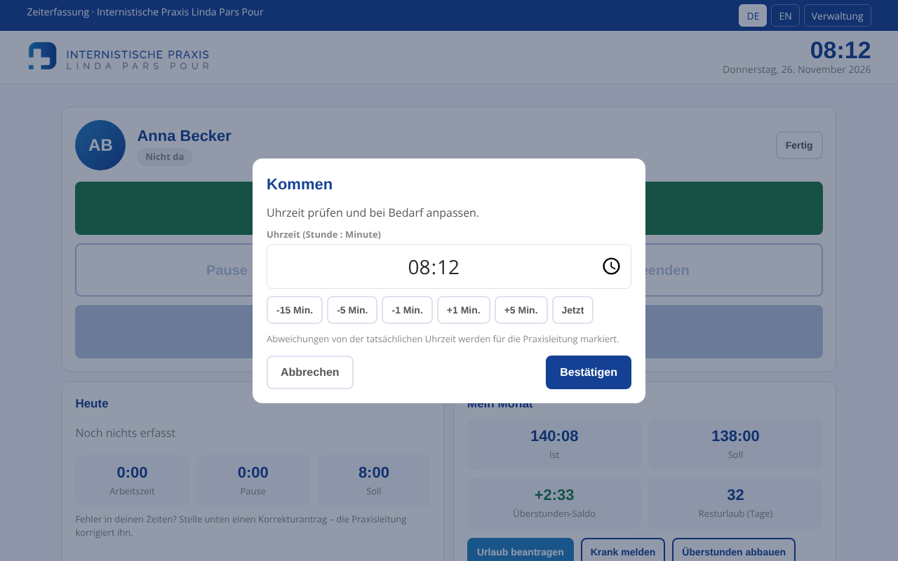

# Technical Documentation – Praxis Zeiterfassung

Version 1.1 · November 2026 · Author: Ario Samani

This document describes how the staff time-tracking app for *Internistische Praxis Linda Pars Pour* (Hamburg) is built, how it calculates working time, and how to deploy, operate and maintain it. For step-by-step instructions for staff and the practice lead, see the German user manual: [Benutzerhandbuch](Benutzerhandbuch.md).

---

## 1. Overview

| | |
|---|---|
| **Purpose** | Record start, breaks and end of each workday for up to 10 employees, manage absences, and produce monthly timesheets |
| **Users** | Employees (clock in/out with a PIN) and the practice lead (admin area with a separate PIN) |
| **Device** | One shared tablet or PC at the reception desk |
| **Type** | Progressive Web App (PWA): a single HTML page, installable, works offline |
| **Data storage** | Browser `localStorage` on the device only; no server, no cloud |
| **Languages** | German (default) and English UI; reports in German |
| **Exports** | Excel (`.xlsx`) and PDF, monthly, per employee or for the whole team |


---

## 2. Requirements (from the practice)

| Requirement | Implementation |
|---|---|
| Up to 10 employees | Staff list capped at 10 active employees |
| Clock-in device not yet decided (PC or tablet) | Responsive layout for landscape tablets, portrait tablets and desktop browsers |
| Reports viewed and controlled by the practice owner | PIN-protected admin area with overview, corrections and reports |
| Monthly Excel and PDF | Summary plus one sheet/page per employee, with logo and signature fields |
| Vacation and sick leave only count after approval | Request workflow with `pending`, `approved` and `rejected` states |
| Variable shifts | Target hours per weekday per employee; actual times may differ daily |
| Practice branding | Colors and fonts from the practice website, practice logo in app and reports |

---

## 3. Architecture

```
┌──────────────────────── Tablet / PC (Chrome, Edge, Safari) ────────────────────────┐
│  index.html  (UI + logic, vanilla JavaScript, no framework)                          │
│     ├─ Kiosk board → PIN pad → employee panel → requests                            │
│     ├─ Admin area → overview · requests · times · reports · staff · settings        │
│     ├─ Calculation engine (targets, holidays, balances, ArbZG checks)               │
│     └─ Export: xlsx.min.js (Excel) · jspdf + autotable (PDF)                        │
│  localStorage["praxis-zeit.v1"]  ← all data as one JSON document                    │
│  sw.js (service worker) ← caches app files for offline use                          │
└──────────────────────────────────────────────────────────────────────────────────────┘
            ▲  static files only (HTTPS)
     GitHub Pages: https://ario-ghs.github.io/praxis-zeiterfassung/
```

- **No backend.** GitHub Pages serves static files. After the first load, the service worker lets the app run without internet.
- **No build step.** `index.html` contains all HTML, CSS and JavaScript. The logo is embedded as a data URI so exports work offline.
- **Third-party libraries** (bundled locally, no CDN at runtime): [xlsx-js-style](https://github.com/gitbrent/xlsx-js-style) (Apache-2.0), [jsPDF](https://github.com/parallax/jsPDF) and [jsPDF-AutoTable](https://github.com/simonbengtsson/jsPDF-AutoTable) (MIT).

---

## 4. Data model

All data is stored as a single JSON object under the `localStorage` key `praxis-zeit.v1`.

```js
{
  ui: "de",                       // UI language
  settings: {
    practice, address,            // shown in header and reports
    state: "HH",                  // German state for public holidays
    adminHash,                    // SHA-256 hash of the admin PIN
    empTimeout: 30,               // seconds until the employee panel closes
    adminTimeout: 180,            // seconds until the admin area closes
    manualTime: true,             // employees may choose the time when stamping
    lastBackup, demo
  },
  emps: {                         // employees by id
    "<id>": { id, first, last, role, contract,
              plan: [Su,Mo,Tu,We,Th,Fr,Sa],   // target hours per weekday
              vacYear, vacCarry, otOpen,      // vacation days, carried days, carried overtime (h)
              trackFrom: "YYYY-MM-DD", active, pinHash }
  },
  days: {                         // punches per employee and date
    "<id>": { "YYYY-MM-DD": { ev: [ { t: "in"|"break"|"back"|"out", at: "HH:MM", nd?: true,
                                      rec?: "HH:MM", man?: true } ],
                              note, updated } }
  },
  reqs: [ { id, emp, type: "vac"|"sick"|"comp"|"fix", from, to, note,
            status: "pending"|"approved"|"rejected", created, decided, comment } ],
  audit: [ { ts, emp, date, before, after, reason } ]   // newest first, max 2,000 entries
}
```

`nd: true` marks a punch after midnight that belongs to the previous day's shift. `rec` stores the real device time when the employee chose a different time; `man: true` marks a difference of more than 2 minutes.

---

## 5. Calculation rules

### 5.1 Daily target
`target = plan[weekday] × 60 minutes`, and **0 on public holidays** of the selected state. Holidays are computed locally (Easter-based and fixed dates, including state-specific days such as Reformationstag in Hamburg).

### 5.2 Worked time
Punches are sorted by time (`nd` adds 24 hours). Time between `in`/`back` and the next punch counts as work; time between `break` and `back` counts as break. For the current shift, the running time up to "now" is included.

### 5.3 Day types and actual time

| Day type | Source | Actual time (Ist) | Difference |
|---|---|---|---|
| Work | Punches exist | Net worked minutes | Ist − target |
| Vacation, sick | Approved request | = target | 0 |
| Time off in lieu | Approved request | 0 | − target |
| Public holiday | Holiday calendar | 0 (target is 0) | 0 |
| Missing | Target > 0, past date, no punches, no request | 0 | − target |

Pending requests never count. A day with a pending request is not flagged as missing.

### 5.4 Overtime balance
`balance = carried overtime + Σ difference` for every completed day from `trackFrom` up to today. Today counts only once the employee has clocked out.

### 5.5 Vacation
Remaining vacation = yearly days + carried days − approved vacation days that have a target > 0 in the calendar year.

### 5.6 Working Time Act (ArbZG) warnings
Shown to employees and the admin; they do not change any figures:
- more than 6 h work with less than 30 min break, or more than 9 h with less than 45 min (§4),
- more than 10 h work per day (§3),
- less than 11 h rest since the previous shift (§5).

### 5.7 Night shifts
If an employee has an open shift from yesterday and today has no punches yet, punches before 12:00 are assigned to yesterday with `nd: true`.

---

## 6. Workflows

### 6.1 Clocking
Board → tap card → PIN (4 digits, hashed and compared) → buttons that are valid for the current state (`off → in → break ↔ back → out`). After a punch the app shows a confirmation and returns to the board.

### 6.2 Employee-chosen times (v1.1)
Requested by the practice: when an employee taps a stamp button, a time picker opens with the current time. The employee can set hour and minute (or use -15/-5/-1/+1/+5 minute buttons). Rules:
- the time may not be more than 5 minutes in the future,
- it must not be earlier than the last punch of the same shift,
- the real device time is kept in `rec`; differences over 2 minutes set `man` and are shown as ✎ in the admin area, explained in the edit dialog and noted in the Excel/PDF reports ("Zeit selbst gewählt: … (gestempelt …)").

The practice lead can switch this off in Settings (`manualTime: false`); then the current time is always used.



### 6.3 Requests and approval
Employees create requests (`pending`). The admin approves or rejects them with an optional comment. The admin can also enter sick leave or vacation directly (`approved` at once). Time-correction requests (`fix`) are reminders: the admin opens the day, corrects it and marks the request as done.

### 6.4 Corrections and audit log
Only the admin can edit times. Every save requires a reason and writes an audit entry with the before/after summary.


---

## 7. Reports

| | Excel | PDF |
|---|---|---|
| Team export | Sheet "Übersicht" + one sheet per employee | Summary page + one page per employee |
| Single export | One sheet | One page |
| Content per employee | Every day of the month, weekly totals, monthly total, absences, notes, signature fields | Same |
| Layout | A4 landscape, fit to width, practice logo on every sheet | A4 landscape, logo and page numbers |

The Excel files are built with xlsx-js-style; print setup and the logo drawing are added by editing the generated `.xlsx` package before download.


---

## 8. Security and privacy

- **Local only.** No personal data leaves the device. GitHub Pages hosts only the code and the logo.
- **PINs** are stored as SHA-256 hashes (salted with the employee id or `admin:`), never in plain text.
- **Separation:** employees see only their own data. All data requires the admin PIN.
- **Auto-close:** employee panel after 30 s, admin area after 3 min of inactivity.
- **Audit trail** for all corrections.
- **Limits:** a 4-digit PIN protects against mix-ups and casual access, not against a determined attacker with access to the device's browser tools. The device itself should be protected by an OS account or screen lock. The practice should inform employees about the time recording (GDPR/DSGVO transparency).

---

## 9. Deployment

1. Repository: `ario-ghs/praxis-zeiterfassung` (public; contains no personal data).
2. GitHub Pages: **Settings → Pages → Deploy from a branch → main / (root)**.
3. On the reception device, open the Pages URL in Chrome or Edge and install the app (see the manual, chapter 2).
4. Complete the first setup (admin PIN), add employees, and save a first backup.

### Updating
Upload the changed files to the repository. Bump the cache name in `sw.js` (`praxis-zeit-v1` → `v2`, …) so devices load the new version. Data on the device is not affected by updates.

---

## 10. Backup and restore

- **Backup:** Settings → *Sicherung speichern* downloads the complete JSON state. Recommended weekly, stored on a USB stick or practice drive.
- **Restore:** Settings → *Sicherung laden* replaces the current state with the file's content.
- **Risks without backup:** device loss or failure, clearing browser data, or uninstalling the app deletes all records.

---

## 11. Browser support

Tested in Chromium (desktop and tablet viewport sizes). Designed for current Chrome, Edge and Safari. Requires a secure context (HTTPS) for PIN hashing and the service worker.

---

## 12. Known limitations and possible next steps

| Limitation | Possible next step |
|---|---|
| Data on one device only | Optional encrypted cloud sync (EU hosting, data processing agreement) |
| No automatic backup | Scheduled backup reminder or export to a network folder |
| Reports in German only | English report option |
| No shift planning | Weekly roster with planned shifts per employee |
| No payroll interface | CSV export in the format of the practice's payroll software |

---

## 13. File list

| File | Purpose |
|---|---|
| `index.html` | Complete app (UI, logic, embedded logo) |
| `manifest.json` | PWA metadata (name, icons, colors) |
| `sw.js` | Service worker for offline use |
| `xlsx.min.js` | Excel export library |
| `jspdf.umd.min.js`, `jspdf.plugin.autotable.min.js` | PDF export libraries |
| `logo.png`, `icon-192.png`, `icon-512.png` | Practice logo and app icons |
| `docs/Benutzerhandbuch.md`, `docs/Benutzerhandbuch.pdf` | German user manual |
| `docs/DOCUMENTATION.md` | This document |
| `docs/screenshots/` | Screenshots used in the documentation |

## 14. Changelog

| Version | Changes |
|---|---|
| 1.1 | Employees can choose the clock time when stamping (requested by the practice); chosen times are marked for the admin and noted in reports; setting to switch it off |
| 1.0 | First release |
